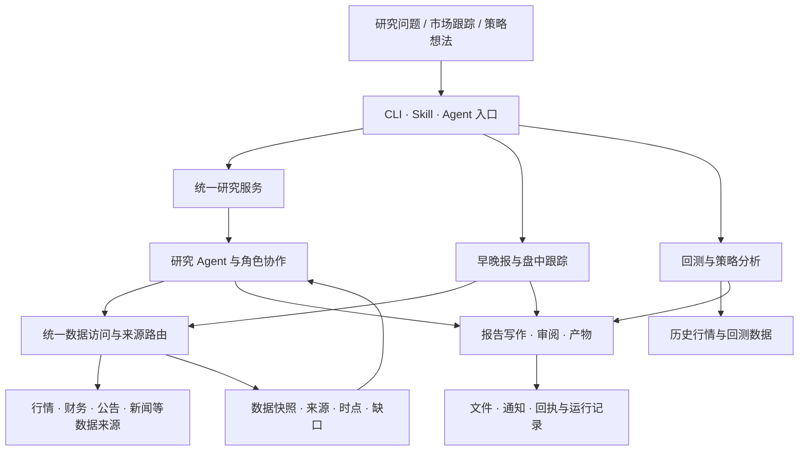

# Stock Research · AI 股票研究与分析框架

一个持续迭代的个人研究项目，把金融数据、AI Agent、量化回测与报告工具连接起来，支持公司深度研究、市场跟踪和策略分析。项目围绕实际研究问题设计：**从分散的信息中找证据，形成可复核的判断，并把结果呈现为可阅读的报告。**

> 本仓库是公开的架构和成果展示，不包含业务源代码、个人账户数据或交易记录。下文按 2026 年 11 月的项目代码及文档整理；实现、设计和实际运行效果分别说明。

## 项目解决什么问题

- **研究一家公司**：收集公告、财报、行情和行业材料，分析业务、财务、估值与风险，并跟踪哪些问题仍需补证。
- **理解市场变化**：汇集行情、新闻和公司动态，生成早晚简报与观察计划，支持盘中跟踪。
- **检验交易想法**：基于历史数据、策略规则和交易约束开展回测，查看收益、回撤和执行情况。
- **提高研究效率**：让 Agent 组织研究、阅读资料、调用工具及写作审阅；由确定性程序负责数据、计算、状态和边界。

## 系统架构

图中表示职责关系，不代表所有环节都运行在同一进程或每条路径均已完成端到端验收。

从职责上看，系统分为四层：**入口与任务组织**负责理解用户需求并选择研究路径；**研究与分析**负责公司、市场和策略问题；**数据与工具**提供行情、财务、资料检索和计算能力；**产物与运行管理**负责报告、过程记录和交付状态。各层通过明确的输入和结果连接，便于替换数据来源、增加研究能力和定位问题。

### 统一数据与证据

通过统一数据入口和能力执行层对接不同市场、数据类型和供应商。上层研究使用行情、历史 K 线、财务、公告、新闻等能力；来源路由、调用尝试和数据缺口留在结果中，便于检查和补充。不同数据源的覆盖与可用性会变化，结果按实际来源和状态判断。

研究过程尽可能记录证券主体、数据期间、来源及可得时间；缺失时如实标注。使用快照和证据材料支撑结论；历史研究与回测关注当时是否可以获取信息。公开检索可以补充背景和反证，并标明来源及时间。

数据层的重点不是把多个接口简单堆在一起：它需要把证券、指标和时间口径对应到同一个研究问题，向上提供可消费的结果，并保留失败、部分可用或来源冲突的情况。研究者可以利用已有材料继续分析，也可以针对缺口再检索，不必因为某一项资料缺失而丢弃全部成果。

### 公司研究与 Agent 协作

统一研究入口组织资料获取、研究分析和输出。研究 Agent 根据问题选择材料、提出疑问、检索补证，结合财务与行业信息解释业务和风险；对于适合的问题，可使用预期差、产业链与前瞻估值等研究能力。

研究、观点分析、写作和审阅可分角色进行。研究判断由 Agent 结合材料完成；证券身份、精确计算、证据关联和持久状态由工具处理。报告保留事实、分析、假设与缺口之间的区别，避免把材料不足说成确定结论。

一项公司研究通常经过以下环节：

1. **明确问题与主体**：确认研究对象、时间范围及关注点，识别已有研究和待回答的问题。
2. **收集并组织材料**：获取相关财务、公告和行业信息，整理来源、时点及可用性。
3. **分析和补证**：结合业务结构、盈利驱动、竞争环境与估值提出判断，并寻找可能推翻判断的证据。
4. **形成报告与复核**：把结论、依据、风险和后续观察点组织为报告；按任务需要进行独立审阅、修订和复核。

这是一套可按研究问题调整的工作方式：不同公司需要关注的业务、资料和估值方法不同，Agent 可围绕具体问题选择工具和分析路径。

### 回测与策略分析

回测链路组合历史行情、策略规则、执行模型和结果统计。现有能力覆盖日线、分钟数据及不同执行模式，并考虑 T+1、整手、费用、滑点和涨跌停等交易约束。回测结果记录运行配置和数据条件，分析时关注收益、回撤、成交与数据缺口。

全市场批次和共享资金账户的组合回测是持续建设方向；不能将逐股样本统计当成组合收益，也不能把未完成的数据覆盖或验收描述为全市场已跑通。

回测设计把**策略信号、模拟执行和结果分析**分开：先根据指定数据和规则产生信号，再结合市场交易约束模拟订单与资金变化，最后统计表现并检查数据缺口。这样可以分别讨论“想买卖什么”和“在当时的市场条件下能否成交”，也便于比较不同假设。

### 早晚报与盘中跟踪

早晚报围绕市场行情、新闻公告、公司动态和观察条件组织内容。晚报形成下一交易日的观察计划，早报结合新增事实更新；盘中跟踪可结合行情和既有计划检查条件变化。研究内容、报告生成与消息投递分别记录状态；生成文件不等于收件人已经收到。

内容组织兼顾两个层次：先呈现市场主要变化和重要事件，再结合关注的公司或方向整理关键条件。盘前与盘后材料可以相互衔接；当新的行情或消息改变前提时，观察计划也应随之更新。具体内容与交付情况取决于当次可用数据和运行结果。

### 运行与恢复

任务和产物尽可能保留输入身份、配置、状态和回执，以便核对及恢复。对执行或投递状态未知的请求，保留原有记录并先核实，不把未知直接当成失败或成功。研究建议由使用者判断；真实交易操作有独立授权及约束。

对于长时间研究或多步骤报告，系统根据任务及可用路径保存材料、阶段结果与最终产物，便于查找依据、定位失败环节和复用已有成果。局部来源失败或某项数据缺失时，保留可用结果并说明影响，后续可针对缺口继续处理。

## 技术与工程实践

| 方向 | 实践 |
|---|---|
| 研究编排 | Python 服务、CLI、Skill、Agent 工作流、模型路由与工具调用 |
| 数据接口 | 统一能力入口、供应商适配、来源尝试与数据质量记录 |
| 研究留痕 | 快照、来源与时间、研究材料、缺口、运行记录 |
| 回测 | 策略与执行分离、交易约束、结果和运行配置记录 |
| 交付 | Markdown / HTML / PDF 等报告产物，以及通知和回执处理 |
| 验证 | 按模块进行测试与独立审查，区分设计、实现、真实运行和交付结果 |

## 研究报告样例

[金安国纪（002636.SZ）综合研究报告 · 2026-11-12](samples/jingan-research-20261112.md) 展示了公司研究、财务分析和证据整理的输出。报告保留当时的研究时点、框架数据缺口与补充材料说明；页面可直接阅读，也可下载原始 PDF。

这个案例围绕“利润增长来自什么、能否持续”展开：结合财报和补充材料还原单季度指标，分析售价、成本、应收和现金流的变化，再整理判断依据与后续观察点。报告明确记录了当次框架数据缺口及补充研究，展示的是研究过程和结果，而非全自动闭环已完成的证明。

本文对回测和早晚报介绍的是框架能力，尚未在此仓库提供对应的公开运行样例。

## 当前边界与后续方向

- 公司研究、回测、简报等功能已有代码和研究产物；不同模块的接入、数据覆盖和线上运行状态不完全相同。
- 深度研究的多角色审阅及报告交付链仍在完善，不能以局部测试代替完整真实运行验收。
- 全市场回测的数据覆盖、历史证券范围及完整结果仍需验证；不以设计目标或局部样本代表最终结果。
- 继续优化 Agent 的材料访问、协作与评估，改进数据来源和缺口处理，并验证报告生成到交付的完整链路。

## 关于本仓库

本仓库仅展示系统设计和研究样例，不包含项目源代码或个人账户数据。历史设计样例保留在 [samples](samples/)；其中技术细节反映各自撰写时点，不能自动视为当前运行配置。
