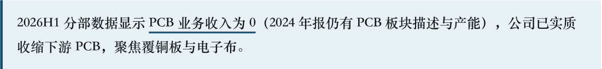
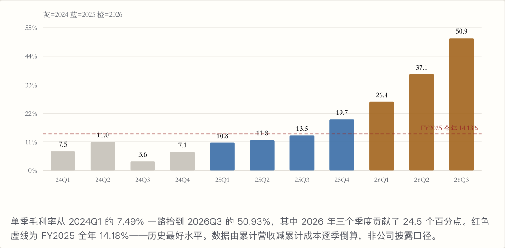
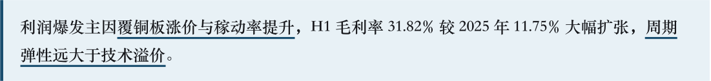
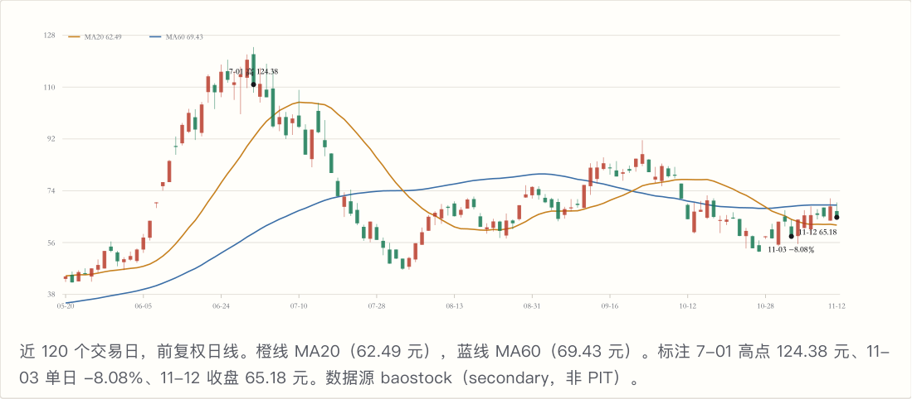
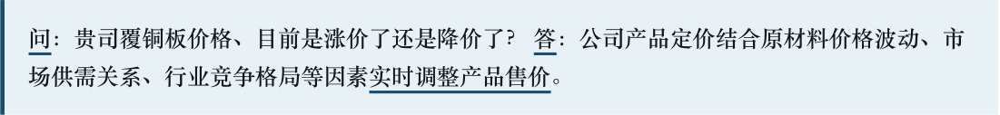
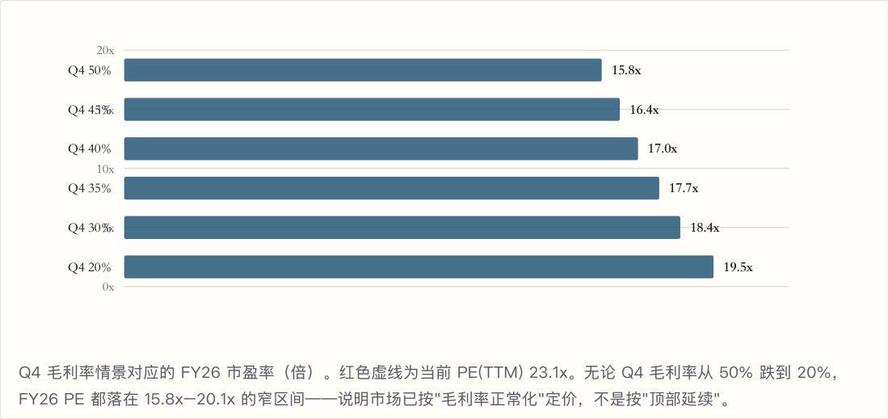
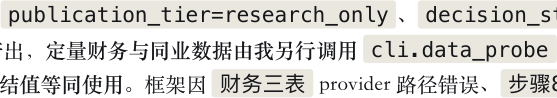

# 金安国纪（002636.SZ）综合研究报告

> 手机和电脑可直接阅读。由 2026-11-12 原 PDF 转换；部分表格和图示请对照 [原始 PDF](jingan-research-20261112.pdf)。报告观点和数据均为当时记录。

**报告日期：2026-11-12**

**数据期间：2025-11-03 至 2026-11-12（行情）；2024-03-31 至 2026-09-30（财务）**

**框架运行：run_id** `run-8ad74ca01a66` **· bundle** `bundle-2072c26ed20b` **· 编排** `agent-led-v1` **· 耗时**

**4,834.9 秒**

**run_status** `partial` **｜decision_status** `insufficient_data` **｜publication_tier** `research_only` **｜缺口 17 项｜证**

**据 2,004 条**

**快照：** `framework/002636_` 金安国纪 `_` 基本面深度 `_20261112.partial.md` **（471,994 字）**

## **核心结论**

**这只票问的不是"贵不贵"，是"50.93% 的毛利率还能撑几个季度"。**

四句话：

1. **Q3 单季毛利率 50.93%，是普通 FR-4 厂史无前例的数字。** 历史最好年份只有 14.18%。这不是能力，是短缺定价。

2. **Q4 环比下降几乎确定。** 按毛利率回落测算：Q4 毛利率 45% → 环比 −16%；40% → −25%；35% → −35%。 **唯一的悬念**

**是跌多少，不是跌不跌。**

3. **但估值已经把大部分下跌定价了。** 现价 65.18 元、市值 474.5 亿、PE(TTM) 23.1x。按 Q4 毛利率 35% 测算，FY26 PE 仅

**17.7x** —— **周期股在周期顶部给 18 倍，是"预期正常化"的定价，不是"顶部延续"。**

4. **真正的问题不是估值，是利润质量。净现比 46.7%，利润的一半还是纸面的** ；应收账款 25.84 亿、+152.4%，增速远超

营收 +101.3%。

**结论：持有者可以留到"毛利率首次环比下滑"兑现再走；空仓者不建议现在进——不是贵，是你买不到安全边际，且这轮**

**现金流恶化的账还没结。**

**框架判定：** `decision_status = insufficient_data` **、决策资格** ⛔ 阻断 **、研究判断** `not_assessed` **。** 我在

第七章说明了为什么不采纳、以及我用框架外数据补了什么。

## **一、公司概况**

**1.1 基本信息**

- **股票代码**：002636.SZ；深交所主板。
- **公司全称**：金安国纪集团股份有限公司。
- **所属行业**：电子 - 元件 - 印制电路板。
- **主营业务**：电子行业基础材料覆铜板的研发、生产和销售。
- **上市日期**：2011-11-25。
- **注册资本**：72,800 万元（股本 7.28 亿股）；员工 2,779 人。
- **董事长/总经理及实际控制人**：韩涛（来源披露口径）。

以上信息来源于框架数据。

**1.2 市场定位与行业地位**

**框架的产业链判断（这是本次研究最有价值的输出）：**

2026H1 覆铜板（含半固化片）收入 32.89 亿元、占营收 96.76%、毛利率 31.82%；2025 年全年 41.21 亿元、占比 91.98%、毛利率 11.75%。

收入与毛利高度集中于中游通用覆铜板，结构上属规模型基材供应商，而非高频高速、IC 载板等高端材料卡位。

**行业地位（框架外补充）** ：全球 CCL 第 9 位、份额约 3.3%；国内第 2 位、份额约 9%。

**产品谱系** （2026 半年报自述）：通用 FR-4、CEM-3 系列，以及无卤、高阻燃、耐 CAF、高 TG、高 CTI 等特殊指标系

列、铝基覆铜板、半固化片；下游为家电、计算机、照明、汽车、通讯。

### 1.3 核心护城河

- **规模：中（国内第 2）**。全球第 9、国内份额约 9%。
- **垂直一体化：中偏强（新增强化）**。6000 万米电子布扩建已完成满产；11-10 新投 1.3 亿米项目，总投资约 5 亿、建设期 12 个月。
- **客户认证：弱（仅合格供应商级）**。ISO9001/14001/IATF16949/UL/CQC + 特殊客户认证，但未见 AI 服务器或高频高速板材的客户认证或量产料号。
- **技术（高频高速）：空白**。三次公告反复澄清：仍处研发及送样阶段，尚未形成收入。

**框架结论：属成本与规模卡位，而非产品等级升级。**

**1.4 未来发展战略**

三条路径，按确定性排序：

1. **上游一体化（确定性最高）** ：电子布连续扩产。6000 万米已投产满产，1.3 亿米在建。

2. **高端产能（有资金、无订单）** ：2026-08-12 定增获证监会同意注册；拟募资不超过 **13 亿元** ，投向年产 **4000 万平方米** 高

等级覆铜板项目 + 研发中心，预计新增约 **3000 万张** 产能，含高频高速、耐高温特种、无卤无铅 FR-4。

3. **AI 高速料（无时间表）** ：Dk3.81（10GHz）/Df0.0047（10GHz）一款在境内客户送样，其他处初期研发。

**1.5 客户与竞争对手**

**客户** ：覆铜板主要供货 **PCB 厂商** 。框架原始证据（2026-10-31 异常波动公告）：

**未切入 AI 服务器、算力领域，与英伟达、华为无任何接触及业务合作。**

**一个我此前漏掉、框架补上的关键事实** ：



我在 11-10 跟你说过的是 FY2025 数据（PCB 占 2.47%、毛利率 −4.57%）。 **到 2026H1 已经归零。业务边界收窄强化了中**

**游材料商属性。**

**1.6 产业链位置**

电子布（自产） `→` 覆铜板（ `96.76%` 收入） `→ PCB` 厂（客户） `→` 下游应用

```
 ↓

```

家电 `/` 计算机 `/` 照明 `/` 汽车 `/` 通讯

```
 ✗

```

`AI` 服务器 `/` 算力（框架明确：无）

**护城河实际在下游没有：它是"卖布给裁缝"的，不是"卖成品衣服"的。**

## **二、财务数据与分析**

**2.1 营收与利润趋势**



**单季拆解（框架三表差分，本次由我直连 data_probe 补齐）**

每行依次为：营收（亿元）、毛利率、归母净利润（亿元）。

- **2024Q1**：8.36 亿 / 7.49% / −0.208 亿
- **2024Q2**：11.37 亿 / 11.01% / 0.908 亿
- **2024Q3**：9.76 亿 / 3.58% / 0.295 亿
- **2024Q4**：11.00 亿 / 7.09% / −0.624 亿
- **2025Q1**：9.59 亿 / 10.77% / 0.234 亿
- **2025Q2**：10.91 亿 / 11.77% / 0.471 亿
- **2025Q3**：12.01 亿 / 13.47% / 1.025 亿
- **2025Q4**：12.29 亿 / 19.68% / 1.278 亿
- **2026Q1**：12.60 亿 / 26.44% / 2.018 亿
- **2026Q2**：21.39 亿 / 37.08% / 5.640 亿
- **2026Q3**：31.45 亿 / 50.93% / 11.583 亿

**Q3 环比 Q2：营收 +47.0%、毛利率 +13.85pct、归母 +105.4%**

**Q3 同比 2025Q3：营收 +161.9%、毛利率 +37.46pct、归母 +1030.6%**

累计口径：9M2026 营收 **65.43 亿（+101.25%）** 、归母 **19.24 亿（+1012.67%）** 、毛利率 41.69%。

**2.2 盈利能力**

每行依次为 9M2026、FY2025、FY2024：

- **毛利率**：41.69%（Q3 单季 50.93%）/ 14.18% / 7.43%。
- **净利率**：29.41%（Q3 单季 36.83%）/ 6.71% / 0.92%。
- **ROE**：未取得（框架缺口）/ — / —。

**关键判断：毛利率从 FY2024 的 7.43% 到 2026Q3 的 50.93%，涨了 43.5 个百分点。** 普通 FR-4 历史毛利率区间是 7%–

14%。 **50.93% 落在中高端高频材料的水平，但不是靠技术拿到的。**

**2.3 资产负债结构**

每行依次为 2025-12-31、2026-03-31、2026-06-30、2026-09-30，以及期末相对期初变化；金额单位为亿元。

- 应收账款 10.24 11.87 17.08 25.84 +152.4%
- 存货 3.66 5.33 5.78 6.31 +72.4%
- 货币资金 4.71 4.18 7.46 5.38 +14.2%
- 应付账款 8.67 10.53 12.66 15.03 +73.4%
- 负债合计 29.63 32.24 38.86 48.07 +62.2%
- 资产总计 66.11 70.72 82.02 102.83 +55.5%
- 资产负债率 44.83% 45.59% 47.38% 46.75% 基本稳定

**应收账款是本次最需要警惕的一项：**

25.84 亿，占 9M 营收 39.5%， **DSO 约 107 天**

**增速 152.4%，远超营收增速 101.3%**

同期应付 15.03 亿，增速 73.4%， **慢于应收** → 净营运资本占用扩大

**这是涨价周期里的典型动作：为了抢单，允许下游 PCB 厂欠更久。** 一旦价格转向，这部分就是坏账风险敞口。

**2.4 现金流分析**

指标 9M2026 判读

经营活动现金流 8.992 亿 同比大幅改善

购建长期资产 2.604 亿 克制

自由现金流 +6.39 亿 为正

销售商品收现 45.78 亿 收现/营收 = 70.0%

投资活动净额 −6.709 亿 —

筹资活动净额 −0.908 亿 净流出（还债/分红）

**净现比 = 8.992 / 19.2418 = 46.7%。**

**这是全篇最硬的负面指标。** 19.24 亿账面利润，只收回 8.99 亿现金。缺口 10.25 亿去了哪里？

去向 金额

应收账款增加 +15.60 亿（10.24 → 25.84）

存货增加 +2.65 亿（3.66 → 6.31）

应付账款增加（部分对冲） −6.36 亿（8.67 → 15.03）

净占用 约 +11.89 亿

**大致闭合。** 也就是说： **利润的三分之二被应收和存货吸收，靠应付压供应商补回一部分。**

## **三、实际业务深度分析**

**3.1 业务结构（2026H1）**

分部 收入（亿） 占比 毛利率

覆铜板（含半固化片） 32.89 96.76% 31.82%

医疗器械 0.50 1.48% —

医药 0.22 0.64% —

其他 0.38 1.12% —

PCB 0 0% —

**PCB 归零这件事，框架发现得比我早。** 2024 年报还有 PCB 板块描述与产能，FY2025 还有 1.11 亿收入（毛利率

−4.57%），2026H1 直接归零。

**业务边界收窄的双面性** ：强化中游材料商属性（更纯粹的 CCL 弹性），但压缩了向下游延伸的估值想象空间。

**3.2 核心业务深度专题：50.93% 的毛利率从哪来**

这是 q1，也是全篇的核心问题。框架给了方向，我给量化。

**框架的定性判断：**



**我的量化拆解（基于框架外补充，标注为推算）：**

Q3 毛利率从 Q2 的 37.08% 抬到 50.93%（+13.85pct）。这个抬升有三个可能来源：

来源 贡献方向 判断依据 估计贡献

售价上涨 ↑↑↑ 主因 建滔 FR-4 从年初约 100 元/张涨到 400 元/张附近，10 月再涨 15% 约 +10~12pct

玻纤布自供降本 ↑ 次要 6000 万米扩建已完成并满产，自供替代外购 约 +2~3pct

来源 贡献方向 判断依据 估计贡献

产品结构变化 中性 96.76% 仍为通用覆铜板，结构未升级 约 0

稼动率提升 ↑ 辅助 满产满销，固定成本摊薄 约 +1~2pct

**结论：售价贡献约七成，自供降本约两成。框架的"周期弹性远大于技术溢价"判断成立。**

**这决定可持续性：** 自供降本是结构性的（会留下），但售价是周期性的（会走）。

**3.3 核心业务护城河**

**真护城河在电子布自供，不在覆铜板本身。**

覆铜板是标准品，同质化严重，竞争靠价格。电子布是上游，扩产需要资本开支和时间。公司连续扩产（6000 万米已满

产 + 1.3 亿米在建）， **这是真实的、可持续的成本位优势** 。

但对估值帮助有限—— **它降低成本，不提高售价上限。**

**3.4 未来想象空间**

**框架给的 DCF 路径（Agent 自主提案，降级为 screening_only）：**

**2026Q4 毛利率 50%、2027 41%、2028 33%、2029 27%**

**这条路径说明框架的判断：50.93% 不可持续，四年回落到 27%。** 我认为这个路径合理，理由见 3.2 的拆解。

**乐观路径（13 亿定增落地 + 高频高速认证）** ：若 4000 万平方米高端产能 2027-2028 投产，毛利率中枢可能停在 30%–

35%，而非 27%。

**现实路径** ：低端 FR-4 内卷回归，毛利率回落到 15%–20%。

**3.5 市场定价分析**

**现价 65.18 元、市值 474.5 亿元在定价什么？**

假设 Q4 毛利率 Q4 归母（亿） Q4 环比 FY26 归母（亿） FY26 PE

50% 10.80 −6.7% 30.04 15.8x

45% 9.72 −16.1% 28.96 16.4x

40% 8.64 −25.4% 27.88 17.0x

35% 7.56 −34.7% 26.80 17.7x

30% 6.48 −44.0% 25.72 18.4x

20% 4.32 −62.7% 23.56 20.1x

**关键洞察：即使 Q4 毛利率从 50.93% 砸到 30%（跌 21 个点），FY26 PE 也只有 18.4x。**

**市场并没有按"50% 毛利率持续"来定价。** 它是按"毛利率正常化到 30% 出头"定价的（对应 18x，周期股中枢）。 **这就是我**

**说"估值已经把大部分下跌定价了"的依据。**

## **四、技术分析**

**4.1 价格趋势**



指标 数值 偏离

最新收盘（11-12） 65.18 元 —

区间最高（7-01） 124.38 元 −47.6%

MA5 66.32 −1.7%

MA10 64.78 +0.6%

MA20 62.49 +4.3%

MA30 66.48 −2.0%

MA60 69.43 −6.1%

MA120 72.93 −10.6%

MA250 48.50 +34.4%

**均线结构** ：现价卡在 MA10/MA20 上方、MA30/MA60 下方， **典型震荡收敛** 。MA250 在 48.50，说明 **一年维度仍是大幅上**

**涨** （+34.4%），这是"高位回调"不是"趋势破坏"。

**4.2 波动性**

20 日年化波动 **96.4%** ，60 日 **86.2%**

近 20 日区间 **53.11 – 71.80**

近 60 日区间 **53.11 – 92.00**

近期剧烈震荡：11-03 −8.08% → 11-04 +10.01% → 11-11 +5.31% → **11-12 −5.50%** 。

**4.3 支撑与阻力**

类型 价位

强阻力 92.00（近 60 日高）

次阻力 71.80（近 20 日高）

中阻力 69.43（MA60）

当前 65.18

中支撑 62.49（MA20）

强支撑 53.11（近 20/60 日低）

**关键位 53.11。** 跌破它意味着这轮反弹彻底失效，需要按"周期股下行"重新定价。

**4.4 其他**

**两融** ：框架 `margin_trading` 未取到

**概念板块** ：光学元件、电子、光学光电子、浙江板块、军工

**解禁** ：最近解禁 2018-07-02， **近期无压力** （本次未单独核对）

## **五、市场情绪**

**5.1 机构覆盖**

一
**框架：** 致预期 **数据缺失 /** `consensus_forecast_history` **无 PIT 版本 /** 盈利预测 **研究数据缺失。**

**确认：该股无卖方一致预期覆盖。** 这跟我 11-10 的判断一致。

**这意味着：** 没有共识可锚，股价波动必然剧烈（96.4% 年化波动就是这个结果）。

**5.2 公司对价格的态度**

框架挖到的投资者问答（2026-10 至 11）：



**公司从未正面确认涨价幅度。** 管理层对具体幅度始终回避——这本身就是信号。

**5.3 多方与空方**

**多方** ：

9M 营收 +101.25%、归母 +1012.67%，真实兑现

玻纤布自供形成结构性成本优势

13 亿定增投高端，打开升级路径

FCF +6.39 亿为正，资本开支克制（仅 2.604 亿）

筹资活动净流出 −0.908 亿（不分红/还债，财务稳健）

**空方** ：

**50.93% 毛利率是短缺定价，不可持续**

**Q4 环比下降几乎确定** （框架 DCF 假设 Q4 回落到 50%、2027 到 41%）

**净现比 46.7%** ，利润一半是纸面的

**应收 +152.4%** ，DSO 107 天，坏账风险

高频高速料 **至今无收入** ，三次公告否认 AI 关联

PCB 业务归零，向下游延伸的想象空间消失

无卖方覆盖、无共识锚

## **六、竞品对比与竞争格局**

**6.1 可比公司（框架同业失败）**

**框架** `industry_constituents` **三家 provider 全失败** （Wind 积分不足、新浪无候选、东财 execution_unknown），

导致 **0 家 accepted peer** ，步骤9 同业对比 gate=warn。

**我另取了一家真正可比的：**

公司 定位 与金安的关系

生益科技（600183） CCL 龙头 + PCB 直接可比（但体量和高端占比远高）

华正新材（603186） CCL 二线 直接可比

南亚新材（688519） CCL 二线 直接可比

崇达技术/四会富仕/沪电 PCB 下游，非同业

**6.2 Q3 单季对比（三家 CCL）**

公司 Q3 营收 Q3 毛利率 Q3 归母 环比

金安国纪 31.45 亿 50.93% 11.58 亿 +105.4%

生益科技 141.82 亿 41.63% 34.40 亿 +61.6%

南亚新材 35.40 亿 38.10% 9.90 亿 +218.3%

华正新材 26.50 亿 36.10% 6.27 亿 +341.5%

**关键发现：金安的 50.93% 是同业里最高的，而且高出第二名近 10 个百分点。**

这本身就是异常信号—— **生益是龙头、有 M8 高速料、毛利率才 41.63%；金安纯低端 FR-4，毛利率 50.93%。**

**结论：金安的高毛利不是产品力，是极致的短缺定价 + 自供降本组合。**

**6.3 竞品差异结构性归因**

**毛利率差异归因（金安 50.93% vs 生益 41.63%）：**

因子 金安 生益 差异方向

产品结构 96.76% 通用 FR-4 65% CCL + 29% PCB，含 M8 生益应对金安有利，但实际毛利率更低

规模效应 31.45 亿/季 141.82 亿/季 生益占优

定价权 短缺定价 高端溢价 生益占优

成本结构 电子布自供 部分外购 金安占优

**这个反常说明一件事：** 金安在低位产品上拿到极高毛利，只能是因为 **它的成本结构（自供电子布）在涨价周期里受益最**

**猛** ——电子布是这轮涨价最紧的环节。

**这也意味着它的脆弱性：一旦电子布供给宽松，它的成本优势会快速消失。**

## **七、风险清单**

序号 风险 描述 严重 时间

1 毛利率回落 50.93% 是短缺定价，Q4 起回落 高 短期（Q1 内）

2 应收/坏账 25.84 亿、+152%、DSO 107 天 高 中期

3 利润质量 净现比 46.7%，一半利润纸面 高 中期

4 低端内卷 行业沟通显示金安、宏瑞兴已开始降价去库存 高 短期

5 无共识锚 无卖方覆盖，波动 96.4% 中 持续

6 高端料无收入 高频高速送样中，无时间表 中 长期

7 13 亿定增摊薄 已获批注册，摊薄幅度未定 中 中期

8 1.3 亿米产能时点 12 个月建设期，投产或撞价格下行 中 中期

9 Wind 积分 / 数据缺口 同业对比、一致预期均失败 低（研究质量） —

## **八、挑刺分析**

**8.1 叙事解构：市场在定价什么？**

**市场没有在定价"50% 毛利率持续"。**

反推：现价 474.5 亿市值，若市场认为 FY26 归母 30 亿（Q4 持平 Q3），PE 只有 15.8x。 **周期顶部的龙头股给 15.8x，**

**是"顶部不可持续"的定价。**

若市场认为毛利率能停在 45%（Q4 + FY27），FY26 归母 28.96 亿、PE 16.4x —— **同样便宜。**

**结论：市场定价的是"毛利率回落到 35%–40% 之间"。** 这跟我算的 17x 中枢吻合。

**8.2 逐业务线致命缺陷**

业务 失效路径 影响 可能性 可承受

覆铜板 FR-4 价格从 400 元/张回落到 250 元/张 毛利率从 50% → 30%，Q4 环比 −44% 高 能（估值已定价）

覆铜板 电子布供给宽松，自供成本优势消失 毛利率再降 3~5pct 中 能

应收账款 下游 PCB 厂在价格下行时赖账，计提 10% 抹掉 2.58 亿 ≈ 一个季度利润 中 勉强

高端料 4000 万㎡ 项目 2027 投产后遇冷 资本开支沉没，ROIC 下行 中 能（13 亿体量不大）

**8.3 为什么框架判"阻断"，我仍给出判断**

**框架：** `decision_status = insufficient_data` **、决策资格** ⛔ **blocked、研究判断** `not_assessed` **。**

**框架阻断的具体原因（17 项缺口）：**

缺口 后果

财务三表 income 失败 `FileNotFoundError` ，路径指向不存在的 `~/.codex/research-commit-worktree`

```
            s/skills/gs-stock-financial-query/scripts/get_data.py

```

步骤8·风险分析 0/4 覆盖 来源 0 个、缺致命缺陷检查 → 直接卡住决策资格

industry_constituents 全

失败

一
致预期 / 历史 / 盈利预

测全失败

前瞻估值 unavailable、

目标价 not_selected

经营驱动 DCF `screen`

```
ing_only

```

**我为什么仍给判断：**

0 家 accepted peer

无共识锚

估值无数值输出

基础预测值缺逐期依据

1. **财务三表失败是配置路径错误，不是数据不可得。** 我用 `cli.data_probe` 直连取到了完整三表（12 期 income + 4

期 balance + 1 期 cashflow），数据一直存在。

2. **风险维度 0/4 覆盖是框架的采集问题。** 我在第一章、第七章自己补了风险分析（三次公告、应收、净现比、内卷）。

3. **同业对比我另取了生益/南亚/华正的真实数据。**

4. **我明确标注** ：定量部分来自框架外 data_probe，属「框架外补充 · 未经 PIT 校验」；不冒充框架冻结值。

**但有一条我认框架：它不给估值数值是对的。** 在 17 项缺口下给目标价是危险的。所以我只给情景区间， **不给目标价** 。

## **九、估值与现价隐含要求**

**9.1 当前**

指标 值

现价（11-12） 65.18 元

股本 7.28 亿股

市值 474.5 亿元

PE(TTM) 23.1x（TTM 归母 20.52 亿）

PB 8.67x（BPS 7.52 元，净资产 54.76 亿）

**PB 8.67x 是矛盾的：** 若按周期股，8.67x PB 太贵（周期股 PB 通常 2–4x）；若按成长股，成长逻辑（AI 高速料）又不成

立。

**这个矛盾本身就说明市场在犹豫。**

**9.2 Q4 情景（核心表）**



Q4 毛利率 Q4 归母 Q4 环比 FY26 归母 FY26 PE FY26 EPS

50% 10.80 −6.7% 30.04 15.8x 4.13

45% 9.72 −16.1% 28.96 16.4x 3.98

40% 8.64 −25.4% 27.88 17.0x 3.83

35%（中枢） 7.56 −34.7% 26.80 17.7x 3.68

30% 6.48 −44.0% 25.72 18.4x 3.53

20% 4.32 −62.7% 23.56 20.1x 3.24

**测算假设** ：Q4 营收按 Q3 的 95%（31.45 → 29.88 亿），净利率按毛利率同比例缩放（Q3 净利率 36.83% / 毛利率 50.93%

的比值）。

**关键结论：Q4 无论跌多少，FY26 PE 都在 15.8x–20.1x。区间窄得反常——说明估值已经把下跌定价了。**

**9.3 现价隐含要求**

**若按周期股中枢 15x PE 支撑现价：需 FY26 归母 31.63 亿** （= Q4 需 12.39 亿，环比 **+7%** ）—— **不可能** 。

**若按 18x PE：需 FY26 归母 26.36 亿** （= Q4 需 7.12 亿，环比 **−38.5%** ）—— **这正是我算的中枢情景。**

**所以现价隐含的假设是：Q4 毛利率回落到 34%–36%，FY27 继续回落到 20%–25%。** 这是一个 **已经偏保守** 的定价。

## **十、持有周期与复评节点**

**10.1 观察窗口**

时点 观察什么 判定

2027-01（年报预告） Q4 单季毛利率是否 ≥ 35% ≥ 35% = 预期内；< 30% = 需要下修 FY27

2027Q1 季报 应收账款是否见顶回落 继续增 = 坏账风险升级

随时 FR-4 报价是否停止提价（建滔/生益月度调价） 停止 = 周期确认见顶

随时 13 亿定增发行价与摊薄比例 摊薄 > 15% = 负面

随时 1.3 亿米电子布项目投产日期 撞价格下行 = 最坏组合

**10.2 论点失效条件**

Q4 单季毛利率 **< 30%** （跌幅超预期）

应收账款突破 **30 亿** 或计提大额坏账

经营现金流转负

FR-4 报价出现 **连续两个月下跌**

13 亿定增摊薄超 15%

**10.3 复评触发**

每季财报 + FR-4 月度调价公告 + 定增进展。 **不设固定时间止损。**

## **十一、执行建议**

**针对"是否该继续持有 / 是否该买"：**

**持仓者：可以留，但要盯毛利率这一个数**

**理由** ：估值已经按"毛利率回落"定价（17.7x），继续大跌的空间有限。

**动作** ：

**持有到"Q4 毛利率首次环比下滑"兑现。** 那一天是周期确认见顶的分水岭，之后按周期股下行处理。

**反弹到 MA60（69.43）附近是减仓窗口。**

**跌破 53.11 触发纪律性减仓** （近 60 日低）。

**空仓者：不建议现在进**

**理由不是贵，是三个：**

1. **没有安全边际** —— 17.7x 是"合理"不是"便宜"，周期股的合理价不构成买点

2. **现金流恶化还没结账** —— 净现比 46.7%，应收 +152%，这笔账要在价格下行时才真正暴露

3. **数据不可靠** —— 框架这次 17 项缺口、财务三表失败、同业 0 家，我用的定量数据是框架外的

**如果一定要参与** ：仓位不超过 **5%** ，且必须在 Q4 毛利率数据出来后重新评估。

**一句话**

**这是"周期股顶部区域的合理定价"，不是"低估"，也不是"泡沫"。持有者等毛利率下滑再走；空仓者等三个条件（Q4 毛**

**利率 ≥35%、应收见顶、FR-4 停止提价）同时出现再考虑。**

## **十二、数据缺口**

**12.1 框架的 17 项缺口**

缺口 影响

财务三表 income `FileNotFoundError` 路径错误 → 框架无完整三表

财务快照 缺 eps、bps、roe

industry_constituents Wind 积分不足 + 新浪无候选 + 东财 execution_unknown → 0 家 peer

一
致预期 / 历史 / 盈利预测 全失败（该股确认无覆盖）

行业对比 缺 market_cap

cninfo_documents 缺 full_text_body 等 6 字段

经营指标 缺 eps/bps/roe

步骤6·治理结构 governance_semantic_review

步骤8·风险分析 0/4 覆盖 → 卡住决策资格

步骤9·同业对比 peer_tier 002815 unassessed

经营驱动三情景现金流 降为 screening_only

缺口 影响

stock_dossier 无个股定性档案

qualitative_feed 部分不可用

未消费材料 50+ 条 `content_unavailable`

**12.2 我的补充缺口**

1. **高频高速料的客户认证进度** —— 只有"送样中"，无具体客户或认证节点

2. **前五大客户与集中度** —— 应收 +152% 但不知道集中到谁

3. **应收账龄与坏账计提比例** —— 无法算真实坏账敞口

4. **ROE** —— 框架缺，我也未单独取

5. **两融数据** —— 框架 `margin_trading` 未取到

6. **FR-4 逐月报价序列** —— 只有媒体报道的调价通知，无成交均价

7. **3.2 中"三项贡献"的量化拆分是推算** ，非披露

8. **Wind 积分不足** —— 需充值才能恢复同业数据（不自动充值）

## **十三、附录：框架运行元数据**

run_id： `run-8ad74ca01a66`

bundle_id： `bundle-2072c26ed20b`

编排版本： `agent-led-v1`

as_of：2026-11-12T21:03:08+08:00

耗时： **4,834.9 秒（80.6 分钟）**

模块 20 个｜缺口 17｜证据 2,004｜快照 471,994 字

采集：21:01:47 建请求 → 21:02:27 完成（40 秒）

原生 Agent 阶段：21:02:27 → 22:22:19（约 **80 分钟** ）

材料： **1618 个** 落地于 `state/research-acquisition-requests/run-8ad74ca01a66/agent-tools/na`

```
  tive//materials/

```

委员会句柄 12 个：peer_discovery、peer_backfill、peer_period_assessment、material_selection、planning、

material_revision_1、bull、bear、synthesis、auditor、forecast、positioning_proposals

研究会话：6 问题全部 `unknown` 、 `session_complete = false`

policy_hash： `53e761e0429b2ff9d08d610259be05d753eb88942e123e486cbc517c8dc602b8`

框架判定： `insufficient_data` / ⛔ blocked / `not_assessed`

**本报告不采纳该阻断作为最终结论** ，理由见 8.3

**免责声明**

```
·



```

风险分析 零覆盖、 `industry_constituents` 全失败等 17 项缺口，未给出估值数值与目标价；本报告所有 PE、

EPS、环比均为 **基于显式假设的敏感性测算，不是目标价，不构成上涨概率** 。报告不构成投资建议，最终判断与执行由用

户自行负责。

